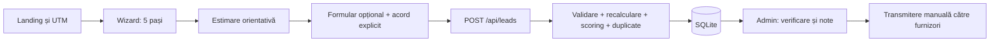

# Arhitectură și reguli de business

[Înapoi la wiki](README.md)

## Scop și limite

Instrument independent pentru proprietari din România, prima nișă: baterii pentru
sisteme fotovoltaice / prosumatori. Mesaj: „Calculează. Compară. Decide dacă merită.”
UI public în română, cu diacritice, mobile-first. Rezultatul este orientativ și
apare înainte de orice cerere de date personale.

Nu există marketplace, plăți, wallet, abonamente, conturi pentru instalatori,
calcul de amortizare sau cumpărare/transmitere automată de leaduri.

## Stack și organizare

Next.js 16 App Router, React 18, TypeScript strict, Tailwind 4, Node 24, npm.
Output standalone; Docker multi-stage, procesul de producție rulează ca `node`.
SQLite prin `node:sqlite`, fără serviciu DB extern/ORM. Zod pentru scheme comune.
Referința inițială a fost `~/CuStraini/custraini-frontend`, care rămâne independentă.

| Zonă                                      | Fișiere importante                                                  |
| ----------------------------------------- | ------------------------------------------------------------------- |
| Landing, pagini publice și SEO            | `app/`, `app/layout.tsx`, `app/robots.ts`, `app/sitemap.ts`         |
| Wizard și rezultat                        | `components/Calculator.tsx`, `components/Result.tsx`                |
| Validarea pașilor și reluarea progresului | `lib/validation.ts`, `lib/calculatorWizard.ts`                      |
| Formula bateriei                          | `lib/batteryCalculator.ts`                                          |
| Scoring                                   | `lib/leadScoring.ts`                                                |
| Telefon                                   | `lib/phone.ts`                                                      |
| Formular și salvare                       | `components/LeadForm.tsx`, `app/api/leads/route.ts`, `lib/leads.ts` |
| DB și migrații                            | `lib/db.ts`, `db/migrations/`, `scripts/db.mjs`                     |
| Admin și sesiuni                          | `app/admin/`, `app/api/admin/`, `lib/auth.ts`                       |
| Securitate și rate limit                  | `lib/security.ts`                                                   |
| Acord și versiune politică                | `lib/privacy.ts`, `app/confidentialitate/page.tsx`                  |
| Analytics și atribuire                    | `lib/analytics.ts`, `components/Tracking.tsx`                       |

## Flux

Pagini: `/`, `/calculator-baterie`, `/rezultat`, `/multumim`, `/confidentialitate`,
`/termeni`, `/admin/login`, `/admin`, `/admin/leads`, `/admin/leads/[id]`.

## Calculator

Principalul indicator este consumul de seară/noapte. Categoriile folosesc valori
reprezentative 3, 6, 10 și 15 kWh, prezentate ca estimări, nu măsurători.

| Consum de seară/noapte          | Interval orientativ    |
| ------------------------------- | ---------------------- |
| sub 4 kWh                       | 5 kWh                  |
| 4–8 kWh inclusiv                | 5–10 kWh               |
| peste 8 până la 12 kWh inclusiv | 10–15 kWh              |
| peste 12 kWh                    | 15+ kWh (`max = null`) |

Dacă utilizatorul nu știe consumul de noapte: `monthlyConsumption / 30 * 0.45`.
Exemplu: 500 kWh/lună → aproximativ 7,5 kWh/zi seara → 5–10 kWh, precizie LOW.
Cu o categorie cunoscută, precizia este MEDIUM; nu există precizie HIGH.

Warning-uri pentru PV mic și interval mare, capacități 15+, backup și sistem PV
încă inexistent. În implementarea curentă, warning-ul pentru PV ≤3 kW se aplică
și intervalului 5–10 kWh, fiind verificată limita superioară a intervalului.
Pentru `backup` și `both` se explică separat necesitatea verificării puterii.
Bugetul și termenul nu modifică formula tehnică. Nicio economie nu este garantată.

Wizard-ul validează fiecare pas separat. Nu folosi validarea integrală ca singura
validare a pasului 1: un câmp obligatoriu lipsă din alt pas poate împiedica
executarea unui refinement condițional. Un draft incomplet revine la primul pas
invalid fără să piardă celelalte răspunsuri.

## Leaduri, scor și duplicate

API-ul validează și recalculează rezultatul server-side. Inputul, rezultatul,
contactul, acordul, versiunea politicii, atribuirea și scorul se salvează împreună.
Telefonul acceptă `07...` / `+407...` și se normalizează în `+407...`.
Emailul este opțional. Nu interpreta formatul valid ca verificare a identității.

Același telefon în ultimele 30 zile marchează `possibleDuplicate` și
`duplicateOfLeadId`. Noul lead se păstrează. Căutarea și inserarea sunt în aceeași
tranzacție SQLite. Status inițial: NEW; note interne separate de notele clientului.

| Criteriu scoring                                 | Puncte               |
| ------------------------------------------------ | -------------------- |
| Proprietar                                       | 20                   |
| ASAP / 30 zile / 1–3 luni / 3–6 luni / informare | 25 / 20 / 15 / 5 / 0 |
| Buget cunoscut                                   | 15                   |
| Are panouri                                      | 10                   |
| Județ completat                                  | 5                    |
| Telefon cu format valid                          | 15                   |
| Calculator completat                             | 10                   |

Maximum 100. HOT ≥70, WARM ≥45, COLD <45. Scorul este intern și nu garantează
intenția de cumpărare: completitudinea datelor poate genera HOT chiar la informare.

## Admin și tracking

Admin cu credentials din ENV, scrypt și sesiune HMAC de 8 ore, cookie HttpOnly,
SameSite Strict și Secure pentru HTTPS. Fiecare API admin verifică sesiunea.
Mutațiile verifică Origin față de APP_URL. Lista are filtre, căutare, paginare și
CSV filtrat, cu protecție împotriva formulelor Excel. Statusurile au istoric.

UTM-urile sunt păstrate în sessionStorage; nu persistăm contactul acolo.
Evenimente: landing_view, calculator_start, calculator_step_completed,
calculator_completed, lead_form_opened, lead_form_started, lead_submitted.
GA4 este opțional și necesită acord separat. La lansare nu era configurat.

Schimbarea textului/politicii cere și schimbarea `PRIVACY_POLICY_VERSION` în
`lib/privacy.ts`. Versiunea de lansare: `2026-10-30.v1`. Leadurile vechi păstrează
textul și versiunea acceptate. Schimbarea statusului nu trimite automat date.
